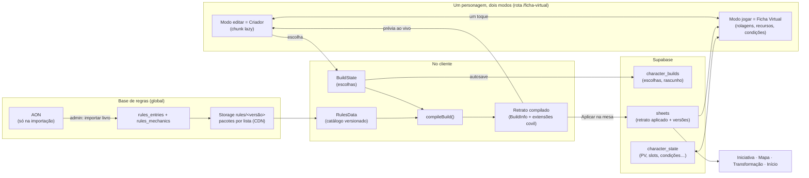

# Arquitetura do Criador de Personagem

## 1. Visão em uma figura



Quatro ideias guiam tudo:

1. **Um personagem, dois modos.** O Criador não é um lugar separado que "manda" a ficha para a Ficha Virtual: é o modo
   *editar* do mesmo personagem. Na Ficha, o dono/GM toca **Editar** e o Criador abre ali mesmo (chunk próprio); toca
   **Jogar** e volta. Nada de arquivo, upload ou export.
2. **Escolhas, não números.** O banco guarda o `BuildState` (o que o jogador escolheu). Os números são derivados.
3. **Retrato aplicado.** O modo jogar lê o retrato que foi **aplicado** — não o rascunho que está sendo editado. Assim a
   mesa não vê números mudarem no meio do combate, o histórico/restaurar continua funcionando, e o servidor (descrições,
   guia por IA, aquecimento da AON) segue lendo um formato que já conhece. O retrato começa no formato `BuildInfo` e
   ganha extensões que a Ficha passa a usar (CONTRATO-FICHA §7).
4. **Aplicar reaproveita o preparo.** "Aplicar na mesa" grava o retrato pelo mesmo rascunho/preparo/promoção de hoje
   (descrições pt/en e guia ficam prontos antes de valer).

### Por que não ler o `BuildState` direto na Ficha (sem retrato)?

Seria a integração mais "pura", mas custa caro e piora a mesa:

| Opção | Prós | Contras |
| --- | --- | --- |
| **A. Ficha compila na hora a partir do `BuildState`** | Uma fonte só | 88 arquivos da Ficha e 3 do servidor teriam de mudar de formato de uma vez; o servidor é JS puro e não roda o motor TS (preparo de descrições e guia quebrariam); toda edição em rascunho apareceria para a mesa no meio do combate; restaurar/histórico teriam de ser refeitos; Iniciativa/Transformação/Mapa também mudariam |
| **B. Retrato aplicado + extensões (escolhida)** | Nada quebra no dia 1; a mesa só vê o que foi aplicado; a Ficha evolui campo a campo; o upload antigo convive na transição | Duas camadas para manter coerentes (resolvido: o retrato é sempre derivado, nunca editado à mão) |
| C. Manter o JSON do Pathbuilder como formato definitivo | Zero mudança | Herda as limitações do Pathbuilder para sempre (sem desarmados, sem origem dos números, casamento por nome) |

A opção B chega no mesmo lugar que a A — a Ficha lendo dados ricos do Criador — sem um "big bang".

## 2. Pastas e arquivos

```
src/modules/character-builder/
  AGENTS.md                      ← regras do módulo (criado na fase 1, no estilo dos outros)
  CharactersPage.tsx             ← rota /personagens (lista da mesa, novo, importar)
  BuilderMode.tsx                ← o modo editar, montado pela Ficha em ?modo=editar (lazy)
  types.ts                       ← BuildState, Choice, Warning, Pending, RulesData (tipos)
  engine/                        ← TS puro, sem React, sem fetch (testável por script)
    compile.ts                   ← compileBuild(state, rules) → { build, warnings, pending, breakdown }
    slots.ts                     ← quais escolhas cada nível abre (classe + variantes + concessões)
    attributes.ts                ← boosts, flaws, parciais, override
    proficiency.ts               ← ranks por estatística, ordem de aplicação, tetos
    skills.ts                    ← treino, aumentos, Lores, duplicidade
    feats.ts                     ← slots, qualificadores, concessões encadeadas, dedicações
    prereqs.ts                   ← avaliador de pré-requisitos (parser + casos), motivo legível
    rule-elements.ts             ← subconjunto suportado (ChoiceSet, GrantItem, ActiveEffectLike…) e "não suportado"
    spells.ts                    ← conjuradores, slots, foco, inatos, rituais
    equipment.ts                 ← armas/armaduras/escudos/itens, runas, materiais, carga, dinheiro
    defenses.ts                  ← CA, salvaguardas, Percepção, CD de classe, resistências
    strikes.ts                   ← ataque/dano das armas e desarmados (o que vai em weapons[])
    companions.ts                ← pets/familiars no formato do export
    variants.ts                  ← Free Archetype, Mítico, Ancestral Paragon, ABP, PwL
    export.ts                    ← monta o BuildInfo (CONTRATO-FICHA.md)
    import.ts                    ← BuildInfo do Pathbuilder → BuildState (migração)
    warnings.ts                  ← catálogo de códigos de aviso (pt/en)
  rules/
    loader.ts                    ← baixa pacotes do Storage (rules/<versão>) sob demanda, cache IndexedDB
    index.ts                     ← consultas: featsFor(slot, state), spellsFor(caster, rank)…
  components/
    ContentPicker.tsx            ← seletor lista+detalhe (abas, filtros, busca, virtualizado)
    LevelPlan.tsx                ← coluna do plano 1–20
    StatusHeader.tsx             ← resumo ao vivo (PV, CA, salvaguardas…)
    PendingPanel.tsx             ← pendências e avisos
    AttributeBoostsDialog.tsx, SkillIncreasesDialog.tsx, ItemOptionsDialog.tsx, RunesDialog.tsx…
  sections/                      ← passos/abas: Origem, Classe, Atributos, Perícias, Talentos, Magias, Equipamento,
                                    Companheiros, Detalhes, Revisão
  hooks/
    useBuild.ts                  ← carrega/salva (debounce, rev, rascunho local), aplica escolhas
    useRules.ts                  ← RulesData pronto para o motor
    useCompiled.ts               ← memo do compileBuild
api/_lib/
  build-handler.js               ← rotas do Criador (no state-router)
  build-store.js                 ← character_builds, versions, mesa_rules (mesa como 1º parâmetro)
  build-sanitize.js              ← sanitizeBuildState (par de src/modules/character-builder/sanitize.ts)
scripts/
  import-rules.mjs               ← carga inicial e importação por livro (mesmo núcleo da tela de admin)
  check-builder.mjs              ← testes do motor (paridade com o elenco, invariantes)
api/_lib/rules-import.js         ← núcleo da importação (AON → rules_entries/rules_mechanics → pacotes)
api/_lib/rules-handler.js        ← rotas de admin da base de regras (BASE-DE-REGRAS §7)
src/modules/platform-admin/      ← tela /plataforma/regras (lazy, só admin)
```

**Regra de import**: o motor (`engine/`) não importa nada de `character-viewer/`. O que for comum (ex.: tabela de
proficiência, `parseFeatEntry`) sobe para `src/pathbuilder/` ou para um `src/rules/` compartilhado.

## 3. Ciclo de uma escolha

1. O jogador toca "Talento de Classe (nível 2)" → `ContentPicker` abre com `rules.featsFor(slot, state)`.
2. A lista mostra cada talento com elegibilidade (`prereqs.evaluate(feat, compiledAtLevel)`) e o motivo.
3. Aceitar grava `choices['class-feat-2'] = { id: 'feat:power-attack' }` no `BuildState` (estado muda na hora).
4. `useCompiled` recompila (memo por `state` + `rulesVersion`): novos números, pendências e avisos.
5. `useBuild` agenda `build-save` (1,5 s). Sem rede: fica no rascunho local e reenvia.
6. Concessões encadeadas: se o talento tem `ChoiceSet`/`GrantItem`, o compilador abre novos slots filhos
   (`choices['class-feat-2/choice-1']`) e eles aparecem como pendência.

## 4. O motor (resumo; detalhe em MOTOR-DE-REGRAS.md)

```ts
compileBuild(state: BuildState, rules: RulesData): {
  build: BuildInfo           // pronto para { success: true, build }
  warnings: Warning[]        // { code, level, message, fix?, ref? }
  pending: Pending[]         // slots sem escolha até o nível atual
  breakdown: Breakdown       // memória de cálculo por número (para o resumo e para "por que é +12?")
  slotsByLevel: Slot[][]     // para o plano 1–20 (inclui níveis futuros)
}
```

Fases internas, em ordem fixa (cada fase lê só o que as anteriores produziram):

1. **Coleta** — ancestralidade, herança, background, classe, variantes da mesa.
2. **Concessões** — expande características por nível até o 20 e as concessões dos talentos já escolhidos (`GrantItem`,
   `ChoiceSet`), gerando os slots.
3. **Atributos** — boosts por nível até o atual.
4. **Proficiências** — inicial da classe, depois características e talentos por nível (rank máximo vence).
5. **Derivados** — PV, CA, salvaguardas, Percepção, perícias, CD de classe, velocidade, sentidos, resistências.
6. **Equipamento** — itens, runas, investidos, carga; ataques de arma e desarmados.
7. **Magias** — conjuradores, slots, foco.
8. **Export** — monta o `BuildInfo`; roda os invariantes (CONTRATO-FICHA §5).

## 5. Rotas da API (sem arquivo novo em `api/`)

Todas em `api/state.js` → `state-router.js`, despachadas **antes** de `isSheetRequest` (que engole POST com `action`).

| Método | Rota | O que faz | Quem |
| --- | --- | --- | --- |
| GET | `?builds=1` | Lista os builds da mesa: os meus completos; dos outros, só cabeçalho (nome, classe, nível, dono, publicado) | membro |
| GET | `?build=<id>` | `BuildState` + `rev` + metadados | dono, GM; outros membros só leitura |
| GET | `?buildVersions=<id>` | Histórico (por publicação) | dono, GM |
| GET | `?mesaRules=1` | Regras da mesa (livros, raridade, variantes, exceções) | membro |
| POST | `build-create` | Cria (gera `id` e **slug estável** a partir do nome, único na mesa, checando `sheets`) | membro |
| POST | `build-save` | Grava `state` com `rev` (409 se `rev` velho); `sanitizeBuildState`; teto 64 KB | dono, GM |
| POST | `build-delete` / `build-restore` | Lixeira (30 dias) | dono, GM |
| POST | `build-assign` | Troca o dono (e o da ficha, via `sheet-assign`) | GM |
| POST | `build-apply` ("Aplicar na mesa") | Recebe `buildId` + retrato compilado; confere dono; força `slug` = o do build; grava versão do build; chama o mesmo `draft-create` | dono, GM |
| POST | `mesa-rules-save` | Grava regras da mesa | GM (papel real sempre) |

Consulta de conteúdo: o catálogo mora no **nosso banco** (`rules_entries`, `rules_mechanics`) e o cliente o lê por
**pacotes por lista no Storage** (CDN, sem função e sem consulta ao banco por leitura), com reserva em
`api/search.js?rules=`. **O Criador nunca consulta a AON.** Descrição em inglês sai do `markdown` guardado; a pt pelo
pipeline de `descriptions`. Rotas de admin para atualizar a base: [BASE-DE-REGRAS.md](BASE-DE-REGRAS.md) §7.

Erros novos do servidor entram em `api/_lib/i18n.js` (`EXACT`/`PATTERNS`).

## 6. Aplicar na mesa e o slug estável

**Aplicar** é o momento em que o rascunho do modo editar vira o retrato que o modo jogar e a mesa leem.

- Botão **Aplicar na mesa** no cabeçalho do modo editar, com o resumo do que muda (nível, talentos, magias, itens,
  números principais — `sheetDiff.ts`) e os avisos do motor.
- Por baixo: `build-apply` → o mesmo `draft-create` → preparo (descrições pt/en, guia) → `promote_sheet_draft`. O modo
  jogar mostra "Preparando…" e troca quando o retrato novo fica completo.
- Quem está com a ficha aberta em outro aparelho vê a faixa "Nova versão" (comportamento atual: nada troca sozinho).
- Exija a confirmação em **Aplicar na mesa** durante e fora de sessão (D7). Sair do modo editar preserva somente o
  rascunho e mantém o retrato publicado.
- **Estado da mesa não é tocado**: PV atual, slots gastos, condições, consumíveis e dinheiro acertado continuam em
  `character_state` e casam por slug/nome como hoje (ex.: `consumed.of` e `money.of` já tratam ficha nova com outra
  quantidade).

**Slug estável**: hoje o servidor tira o slug do `build.name` do JSON (identidade do estado da mesa). Com o Criador o
nome pode mudar sem que o personagem mude:

- `character_builds.slug` nasce no `build-create` e nunca muda.
- `build-apply` monta o draft com **esse** slug (lido do banco, não do cliente) e o `build.name` atual. O
  `sheet-handler` ganha um parâmetro interno `slugOverride` usado só por esse caminho.
- Personagem importado do Pathbuilder (fase 7) **herda o slug da ficha publicada** (inclui os `SLUG_ALIASES`), para não
  perder PV, slots, token, anotações e troféus.
- `sheets` ganha `build_id` (nulo = veio de upload do Pathbuilder, sem modo editar até ser importado).

## 7. Integração com os módulos existentes

| Módulo | Integração | Fase |
| --- | --- | --- |
| **Ficha Virtual** | **Modo editar dentro da própria Ficha**: botão Editar/Jogar no cabeçalho (dono/GM), `?modo=editar` na URL, o Criador carregado sob demanda; "Subir de nível" abre o modo editar já no nível novo; atalhos contextuais ("Trocar talento" no drawer de um talento abre o seletor daquele slot). Ficha de upload antigo mostra "Importar para o Criador". A Ficha passa a ler as extensões `covil` (CONTRATO-FICHA §7) | 7 |
| **Meus personagens (`/personagens`)** | Lista da mesa (os meus completos, dos colegas só leitura), "Novo personagem", rascunhos não aplicados | 2 |
| **Início** | Cartão "Criar meu personagem" para quem não tem ficha; "Continuar rascunho"; "Subir de nível" quando o nível muda | 8 |
| **Navegação** | Item "Personagens" em `NAV_ITEMS` (seção JOGO); palavras-chave na busca ⌘K ("criar", "builder", "level up", "subir de nível") | 2 |
| **Mesa (`/mesa`)** | Seção "Regras de criação" (livros, raridade, variantes) | 2 |
| **Membros (`/membros`)** | GM atribui dono do build (mesmo fluxo de `sheet-assign`) | 8 |
| **Iniciativa / Mapa / Transformação** | Nada a mudar: leem a ficha publicada (`loadPresetJson`, `usePublishedSheets`) | — |
| **Notificações** | "Ficha publicada" já existe. Novo (opcional): "rascunho pronto para revisão" ao GM | 8 |
| **Troféus** | Opcional: "Arquiteto" (primeiro personagem criado no Covil), "Veterano" (subir 5 níveis) — `check-trophies` | 9 |
| **Wiki** | Opcional: "Criar página do personagem" com retrato e resumo | 9 |
| **Anotações** | Background/notas do Criador **são** as Anotações da Ficha (`character_notes`), não um campo novo | 8 |
| **Descrições** | Detalhe do seletor usa `DescriptionContent`/`descriptions.ts` (pt/en, correções); o preparo da publicação continua gerando o pacote | 3 |

## 8. Desempenho e bundle

- O módulo inteiro é `React.lazy`. O motor e o `ContentPicker` ficam no chunk do Criador; `DescriptionContent` continua no
  chunk dele (nunca import estático).
- `RulesData` carregado **por tipo e sob demanda**: núcleo (ancestralidades, heranças, backgrounds, classes,
  características de classe) na abertura; talentos por lista (`feats/class/<classe>.json`, `feats/ancestry/<anc>.json`,
  `feats/general.json`, `feats/skill.json`, `feats/archetype/*.json`), magias por tradição, itens por categoria.
- Cache: CDN do Storage (caminho com a versão, imutável) + IndexedDB (chave `pf2e:rules:<versão>:<lista>`, global — não é
  da mesa). Versão atual no `?me=1`; mudou, baixa só as listas usadas.
- Nenhuma chamada à AON no fluxo do Criador (a AON só é lida pela importação do admin).
- Listas longas virtualizadas (janela fixa de linhas, sem biblioteca, ou uma leve só no chunk do Criador).
- `compileBuild` memorizado; recompilação incremental só se medir lentidão (RNF-03).

## 9. Segurança e validação

- `sanitizeBuildState` duplicado (cliente TS ↔ servidor JS) — entra na lista da regra global 7 e no `check-builder`.
- O servidor confere: membro da mesa, dono ou GM, tamanho, forma (ids no formato `tipo:slug`, níveis 1–20, sem campos
  desconhecidos), `rev`.
- O retrato compilado enviado no `build-apply` passa pelo mesmo caminho do upload de hoje (o servidor já aceita JSON do
  Pathbuilder do cliente). **Endurecimento futuro (opcional)**: o servidor recompilar a partir do `BuildState` — exige o
  motor em JS puro compartilhável; avaliar na fase 10.
