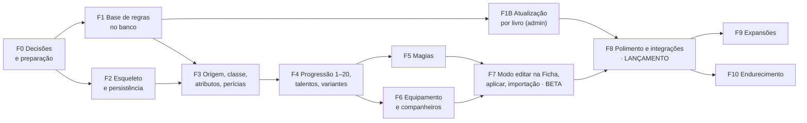

# Roadmap do Criador de Personagem

Do zero até substituir o Pathbuilder. Cada fase tem objetivo, sub-tasks (com checkbox), entregáveis, dependências, o
que rodar e o critério "pronto quando". Tamanho relativo: **P** (dias), **M** (1–2 semanas), **G** (3+ semanas).

Referências: [REQUISITOS](REQUISITOS.md) (RF/RN/RNF/CA), [ARQUITETURA](ARQUITETURA.md), [MODELO-DE-DADOS](MODELO-DE-DADOS.md),
[MOTOR-DE-REGRAS](MOTOR-DE-REGRAS.md), [CONTRATO-FICHA](CONTRATO-FICHA.md), [FONTES-DE-DADOS](FONTES-DE-DADOS.md),
[UX-FLUXOS](UX-FLUXOS.md), [PLANO-DE-TESTES](PLANO-DE-TESTES.md).

## Visão geral

| Marco | Fases | O que o usuário ganha |
| --- | --- | --- |
| **M1 — Protótipo** | F0–F3 | Criar um personagem nível 1 (origem, classe, atributos, perícias) com resumo ao vivo, salvo no banco |
| **M2 — Progressão** | F4 | Plano 1–20 com talentos, pré-requisitos, Free Archetype, Mítico e Paragon |
| **M3 — Beta** | F5–F7 | Magias, equipamento, modo editar dentro da Ficha, aplicar na mesa, importar os personagens atuais; paridade com o elenco |
| **M4 — Lançamento** | F8 | Substitui o Pathbuilder no dia a dia (criar e subir de nível no celular) |
| **M5 — Expansões** | F9–F10 | Homebrew, variantes raras, endurecimento |

Trilhas que podem andar em paralelo (arquivos distintos): **F1** (importação + dados) e **F2** (banco do personagem + API
+ casca da UI); **F1B** (tela de atualização) junto com F2–F4; depois **F5** (magias) e **F6** (equipamento).

Regras de execução válidas em todas as fases:

- Ler o `AGENTS.md` de cada área afetada antes de editar (raiz, `api/`, `supabase/`, `src/services/`, `src/theme/`,
  `src/layouts/`, `src/modules/character-viewer/`).
- **Commits pequenos**, direto na `main`, mensagem em português, um por mudança que se sustenta; sem `git push` sem pedido.
- Antes de dar algo por pronto: `npm run build` + `npm run lint` + o script da área (tabela do `AGENTS.md` raiz).
- Testes no banco: mesa `arton-1515`, slugs `teste-*`, apagar no fim.
- Nenhum arquivo novo em `api/`.

---

## F0 — Decisões e preparação · P

**Objetivo**: fechar as decisões que mudam o desenho e preparar o terreno.

- [x] **0.1** Decidir D1 (fonte da mecânica: Foundry como entrada vs. catalogação à mão) — registrar a decisão e o
      porquê no `AGENTS.md` do módulo.
- [x] **0.2** Decidir D2–D6 (homebrew no MVP, build por mesa, GM cria para jogador, PDF, riqueza inicial).
- [x] **0.3** Confirmar com o GM de cada mesa as variantes ligadas (Free Archetype, Mítico, Ancestral Paragon) e os
      livros liberados — vira a semente de `mesa_rules`.
- [x] **0.4** Fixar o commit do repositório de dados (se D1 = Foundry) e anotar no `FONTES-DE-DADOS.md`.
- [x] **0.5** Criar `src/modules/character-builder/AGENTS.md` (regras do módulo no estilo dos outros: imperativo + porquê
      em uma linha) e a linha dele na tabela "Onde está o detalhe" do `AGENTS.md` raiz.
- [x] **0.6** Acrescentar à regra global 7 os pares novos (`sanitizeBuildState`, `MesaRules`, slug do build).
- [x] **0.7** Exportar do Pathbuilder **um personagem com contêiner com item dentro e com fórmulas** para fechar os
      formatos pendentes do CONTRATO-FICHA §4.

**Entregáveis**: decisões registradas; `AGENTS.md` do módulo; JSON de amostra extra em `scripts/rules-data/samples/`.
**Pronto quando**: não há decisão em aberto que bloqueie F1/F2.

---

## F1 — Base de regras no banco (carga inicial) · G

**Objetivo**: todo o conteúdo de jogador do Remaster da AON no **nosso banco**, com a camada de mecânica, e o Criador
lendo dele sem tocar a AON. Desenho completo em [BASE-DE-REGRAS.md](BASE-DE-REGRAS.md).
**Depende de**: F0 (D1 decide de onde vem a mecânica).

- [x] **1.1** Migration `base_de_regras`: `rules_sources`, `rules_entries`, `rules_mechanics`, `rules_import_jobs`,
      `rules_catalog_versions`, `platform_admins` (semente: a conta `danfigueroa`, D9), extensão `pg_trgm`, grants ao
      `service_role`, bucket público `rules` no Storage (escrita só do servidor). Conferir `pg_database_size` antes.
- [x] **1.2** `api/_lib/rules-import.js` (JS puro, usado pelo script e pela tela): ler livros (`category: source`),
      paginar entradas por livro e categoria com `search_after` e ordenação explícita, intervalo entre páginas,
      retomada por `cursor`.
- [x] **1.3** Normalização por categoria → `rules_entries` (IDs `tipo:aon_id`, nome canônico, nível, raridade, traços,
      livro, `remaster`, `legacy_ids`/`legacy_names`/`replaced_by`, `data` enxuto, `markdown`, `hash`); categorias de
      jogador da lista do BASE-DE-REGRAS §1.
- [x] **1.4** Regra Remaster × legado (BASE-DE-REGRAS §8).
- [x] **1.5** Mecânica `derived` a partir dos campos da AON (ancestralidade, background, classe inicial, armas, magias),
      em `rules_entries.data.derived`.
- [x] **1.6** Mecânica `foundry` (se D1 permitir): rule elements e progressão de classe casados por nome/tipo/`legacy_name`;
      o resto em `unsupported`; relatório dos não suportados mais frequentes (prioriza a F4).
- [x] **1.7** Mecânica `manual`: `spell-slots.json` (cada progressão conferida na AON e com o `perDay` do elenco),
      `wealth.json`, `exports.json` (nomes de conjurador e rótulos de slot do Pathbuilder), `corrections.json`.
- [x] **1.8** `scripts/import-rules.mjs` (`--remaster`, `--source`, `--check`) e **carga inicial** de todos os livros
      Remaster (~17,8 mil entradas).
- [x] **1.9** Geração dos **pacotes por lista** no Storage (`rules/<versão>/<lista>.json`) + `rulesVersion` no `?me=1`;
      rota de reserva `api/search.js?rules=` com `Cache-Control` por versão.
- [x] **1.10** Cliente: `rules/loader.ts` (pacotes do Storage, cache IndexedDB global `pf2e:rules:<versão>:<lista>`, sem
      `mesaKey`) e `rules/index.ts` (`featsFor`, `spellsFor`, `itemsBy`).
- [x] **1.11** Fixture fixa da base no repo para o `check-builder` (testes sem rede nem banco).
- [x] **1.12** Página "Créditos e licenças" (ORC/OGL dos livros importados), bilíngue.

**Entregáveis**: base completa no banco, pacotes no Storage, loader no cliente, script de importação.
**Rodar**: `check-migrations`, `import-rules --check`, reimportar um livro sem mudança = 0 alteradas, build, lint.
**Pronto quando**: contagens por livro batem com a AON; as nove classes do elenco têm progressão 1–20 completa; abrir o
Criador não faz nenhuma chamada à AON (conferir na aba de rede).

---

## F1B — Atualização da base pela plataforma · M

**Objetivo**: o admin baixa só o que é novo — livros novos e erratas — por uma tela, sem script.
**Depende de**: F1. Pode andar junto com F2–F4; precisa estar pronta antes do lançamento (F8).

- [x] **1B.1** Papel de admin da plataforma no servidor (`platform_admins`, conferido em `access.js`); rota
      `/plataforma/regras` (lazy) visível só para admin; item em `NAV_ITEMS` na seção MESA com `adminOnly`.
- [x] **1B.2** `rules-check`: lista os livros da AON com data, errata e contagem; marca NOVO / ERRATA NOVA / Importado /
      Legado (BASE-DE-REGRAS §6).
- [x] **1B.3** `rules-import` + `rules-import-step` + `rules-import-cancel`: job por livros selecionados, passos ≤ 45 s,
      trava, laço conduzido pelo navegador do admin com "Continuar" (mesmo padrão do `sheetPreparation.ts`).
- [x] **1B.4** Diferença por `hash`: novas / alteradas / iguais / removidas (`removed_at`, nunca apagar).
- [x] **1B.5** Fim do job: nova `rules_catalog_versions`, pacotes regenerados só das listas afetadas, relatório e
      notificação aos admins (`mesa_events` ou notificação local).
- [x] **1B.6** Tela: lista de livros com filtros (Remaster/legado, linha de produto), seleção, barra de progresso,
      relatório legível ("412 novas · 9 sem mecânica"), entradas sem mecânica por livro.
- [x] **1B.7** `rules-mechanics-save`: corrigir/preencher a mecânica de uma entrada à mão, com referência AON.
- [x] **1B.8** Verificação semanal automática no cron de `/api/health` → notificação "livros novos na AON" (nunca
      importa sozinho).
- [x] **1B.9** Builds com `rulesVersion` antiga: faixa "Regras atualizadas" no modo editar (RN-13).
- [ ] **1B.10** Pré-traduzir um livro (opcional): fila lenta pelo pipeline de `descriptions`.
- [x] **1B.11** `check-auth`: jogador e GM comuns recebem 403 nas rotas de admin; erros novos em `api/_lib/i18n.js`.

**Pronto quando**: importar um livro novo pela tela (ex.: o mais recente da AON) termina sem script, o Criador mostra o
conteúdo novo depois de recarregar, e reimportar o mesmo livro não muda nada.

---

## F2 — Esqueleto e persistência · M

**Objetivo**: o módulo existe, salva e carrega builds com autorização, e a mesa tem regras de criação.
**Depende de**: F0. Pode andar junto com F1.

- [x] **2.1** Migration `criador_de_personagem`: `character_builds`, `character_build_versions`, `mesa_rules`,
      `sheets.build_id`, grants ao `service_role`, `pg_cron` da lixeira e do teto de versões, semente de `mesa_rules`
      (F0.3). `check-migrations` antes do commit.
- [x] **2.2** `api/_lib/build-store.js` (mesa como 1º parâmetro; fallback em memória) e `build-sanitize.js`.
- [x] **2.3** `api/_lib/build-handler.js` + despacho no `state-router.js` **antes** de `isSheetRequest`: `?builds=1`,
      `?build=`, `?mesaRules=1`, `build-create` (slug estável único na mesa, checando `sheets`), `build-save` (rev/409,
      64 KB), `build-delete`/`build-restore`, `mesa-rules-save` (GM real sempre).
- [x] **2.4** Mensagens de erro novas em `api/_lib/i18n.js`.
- [x] **2.5** `server/index.mjs` servindo as mesmas rotas (dev local).
- [x] **2.6** `types.ts` (`BuildState`, `Choice`, `Warning`…), `sanitize.ts` (par do servidor), `migrateBuildState`.
- [x] **2.7** Rota `/personagens` em `App.tsx` (lazy), item "Personagens" em `NAV_ITEMS` (JOGO), palavras-chave da busca ⌘K; até a F7 o editor abre em `/personagens/:buildId` (rascunho sem ficha) e depois passa a ser o modo editar da Ficha.
- [x] **2.8** `hooks/useBuild.ts`: carregar, salvar com debounce 1,5 s, rascunho local (`mesaKey`), 409 → diálogo.
- [x] **2.9** Tela de lista (RF-001/002): cartões, estados, vazio, "Novo personagem".
- [x] **2.10** Somente leitura para build alheio (reaproveitar `ReadOnlyTheme` e o padrão `VIEW_OK`).
- [x] **2.11** `/mesa` → seção "Criação de personagem" (livros, raridade, variantes, nível/riqueza inicial) — GM.
- [x] **2.12** `check-auth.mjs` com os casos do PLANO-DE-TESTES §3.

**Entregáveis**: tabelas no ar, rotas, lista e editor vazio funcionando com autosave.
**Rodar**: `check-migrations`, `check-auth`, build, lint; conferir 320px.
**Pronto quando**: jogador cria/salva/reabre um build vazio; colega vê somente leitura; GM edita regras da mesa.

---

## F3 — Origem, classe (nível 1), atributos, perícias · G

**Objetivo**: personagem nível 1 "de corpo" com resumo ao vivo.
**Depende de**: F1, F2.

- [x] **3.1** `ContentPicker` (UX §1.3): abas, busca, filtros, ordenação, lista virtualizada, detalhe com
      `DescriptionContent` (lazy), raridade/elegibilidade por linha, teclado, 320px.
- [x] **3.2** Motor — esqueleto de `compileBuild` com as fases (MOTOR §1) e `breakdown`.
- [x] **3.3** Motor — atributos (`attributes.ts`): grupos de boosts, alternativos, flaws, parcial, override, `breakdown`
      do export. Casos no `check-builder`.
- [x] **3.4** Motor — proficiências iniciais da classe e derivados de nível 1: PV, CA sem armadura, salvaguardas,
      Percepção, CD de classe, velocidade, tamanho, sentidos.
- [x] **3.5** Motor — perícias (`skills.ts`): fixas da classe, adicionais + INT, duplicidade, Lores, background.
- [x] **3.6** Telas: Origem (ancestralidade → herança incl. versátil → background), Idiomas, Classe (atributo-chave).
- [x] **3.7** Diálogo de atributos (UX §1.4) e de perícias (pílulas T/E/M/L, "Restam N", Lore livre).
- [x] **3.8** `StatusHeader` (resumo fixo, compacto no celular) e `PendingPanel` (pendências e avisos).
- [x] **3.9** `scripts/check-builder.mjs` (estrutura, invariantes iniciais, casos de atributos/perícias/PV).
- [ ] **3.10** Textos bilíngues (`tr`) e nomes traduzidos conferidos (dicionário de termos do Remaster).

**Entregáveis**: criar um Humano Guerreiro nível 1 completo exceto talentos/itens/magias.
**Rodar**: `check-builder`, build, lint, 320px, tema escuro.
**Pronto quando**: M1 — PV, CA, salvaguardas, Percepção e perícias de um nível 1 de cada classe do elenco batem com o
Pathbuilder (conferido criando os mesmos no Pathbuilder).

---

## F4 — Progressão 1–20, talentos e variantes · G

**Objetivo**: o plano completo por nível, com talentos, escolhas de classe, pré-requisitos e as variantes do elenco.
**Depende de**: F3.

- [x] **4.1** `slots.ts`: slots por nível a partir da classe (`featLevels`, `skillIncreaseLevels`, características) e das
      variantes; chaves estáveis (MODELO §1).
- [x] **4.2** `rule-elements.ts`: `ChoiceSet`, `GrantItem`, `ActiveEffectLike` (proficiência/idioma/sentido/velocidade),
      `MartialProficiency`, `FlatModifier` sem predicado, `BaseSpeed`, `Sense`, `Resistance`/`Weakness`/`Immunity`;
      predicados avaliáveis na criação; `UNSUPPORTED_EFFECT` para o resto.
- [x] **4.3** Escolhas de classe com sub-escolhas (escola, doutrina, causa, instinto, racket, metodologia, consciência,
      estudo híbrido, grupo de Weapon Mastery…) — conferir cada uma na AON para as nove classes do elenco primeiro.
- [x] **4.4** Proficiências por nível (características "Expertise", talentos) com rank máximo e `specificProficiencies`.
- [x] **4.5** Boosts de 5/10/15/20, aumentos de perícia com teto (`SKILL_RANK_CAP`).
- [x] **4.6** `prereqs.ts`: parser dos padrões (MOTOR §11), resultado por parte (ok/fail/unknown), motivo legível pt/en;
      casos no `check-builder` com pré-requisitos reais do catálogo.
- [x] **4.7** `feats.ts`: qualificadores (Assurance (X)), repetíveis, concessões encadeadas (`parentChoice`/`childChoice`),
      dedicação (`DEDICATION_LOCK`), talentos concedidos ("Awarded Feat").
- [x] **4.8a** Mítico completo (REGRAS-OPCIONAIS §1): chamado + Rewrite Fate, talentos míticos nos pares, **destino obrigatório no 12º** e talentos do destino do 14º, mítico por personagem (*Mixed Play*), chamado tardio com pendências liberadas pelo GM.
- [x] **4.8** Variantes do MVP (`variants.ts`): **Free Archetype**, **Mítico**, **Ancestral Paragon** (conferir níveis no
      GM Core/War of Immortals; casar com o elenco).
- [x] **4.9** UI: `LevelPlan` (desktop) e acordeão por nível (celular); nível atual [−][+]; níveis planejados esmaecidos.
- [x] **4.10** UI: seletor de talentos com as abas Classe/Dedicações/Arquétipo/Todos e o motivo de inelegibilidade.
- [x] **4.11** Avisos e pendências completos (MOTOR §15) no `PendingPanel`; escolha órfã com "descartar".
- [x] **4.12** Casos no `check-builder` para slots, concessões, variantes, pré-requisitos.

**Entregáveis**: plano 1–20 navegável e editável.
**Rodar**: `check-builder`, build, lint, 320px.
**Pronto quando**: M2 — os slots e talentos dos 10 personagens do elenco podem ser reproduzidos à mão no Criador (sem
magias/itens), sem pendência fantasma nem slot faltando.

---

## F5 — Magias · G

**Objetivo**: todos os tipos de conjuração do elenco e do Player Core.
**Depende de**: F4. Paralela à F6.

- [ ] **5.1** `spells.ts`: conjuradores da classe, de arquétipo (Basic/Expert/Master Spellcasting), inatos (ancestralidade,
      talento, item), Mythic Magic; tabela de slots (`spell-slots.json`).
- [ ] **5.2** Preparado de grimório (grimório + preparadas com cópias), espontâneo (repertório + assinatura), truques.
- [ ] **5.3** Foco: magias de foco concedidas, pool pelo Remaster (até 3), truques de foco fora da conta.
- [ ] **5.4** Magias concedidas por escolhas (escola, domínio, fonte divina, mistério, consciência).
- [ ] **5.5** Proficiência de conjuração por tradição e por conjurador; CD e ataque com `breakdown`.
- [ ] **5.6** Rituais; slots extras manuais (`bonusSlots`).
- [ ] **5.7** UI: aba Magias com sub-aba por conjurador (UX), seletor por tradição/rank, contadores "Restam N".
- [ ] **5.8** Casos: `perDay` do Psíquico 10, Magus 7/10, Clérigo 7 (Cleric Font), arquétipo de Mago, Aeromancer,
      Mythic Magic; foco do Loki e do Nathaniel.

**Rodar**: `check-builder`, `check-heightening` (nada deve mudar), build, lint.
**Pronto quando**: `spellCasters`, `focus` e `focusPoints` dos conjuradores do elenco batem (CA-01 parcial).

---

## F6 — Equipamento e companheiros · G

**Objetivo**: inventário completo com runas, materiais, carga e dinheiro; ataques prontos; companheiros.
**Depende de**: F4. Paralela à F5.

- [ ] **6.1** `equipment.ts`: itens por categoria, quantidade, comprar/dar, dinheiro (`NEGATIVE_MONEY`), investidos
      (`INVESTED_LIMIT`), contêineres e carga (`ENCUMBERED`), Adventurer's Kit separado.
- [ ] **6.2** Runas: potência/striking/resiliente/reforço/propriedade (slots), a maior substitui a menor; materiais e graus;
      preço composto.
- [ ] **6.3** `defenses.ts`: CA com armadura (teto de DES, potência), penalidades, escudo (fora da CA), resistências de item
      (fim do `addItemResistances`), `mods` de item.
- [ ] **6.4** `strikes.ts`: ataque/dano das armas (FOR/DES/acuidade, propulsivo, striking, especialização pela
      característica), **desarmados** (punho + `Strike` de ancestralidade/talento), overrides com aviso.
- [ ] **6.5** UI: aba Equipamento (dinheiro, volume, lista por contêiner), seletores de arma/armadura/item, diálogo de
      opções da arma e de runas (UX §1.4).
- [ ] **6.6** Riqueza inicial (nível 1: 15 po; nível N: referência da tabela — D6).
- [ ] **6.7** `companions.ts` + UI: companheiro animal (tipo, maduro, incrível, especialização, armadura) e familiar
      (habilidades); export `pets`/`familiars`.
- [ ] **6.8** Livro de fórmulas (formato fechado na F0.7).
- [ ] **6.9** Casos: armas e armaduras do elenco (inclui Cold Iron/Silver, Greater Striking), Arachnid Harness
      (resistência), Ardagar (companheiro Savage Bear).

**Rodar**: `check-builder`, `check-economy` (custos de ativáveis seguem iguais), build, lint.
**Pronto quando**: `weapons`, `armor`, `equipment`, `money`, `acTotal`, `mods`, `resistances`, `pets` do elenco batem.

---

## F7 — Modo editar na Ficha, aplicar na mesa e importação · G → **BETA**

**Objetivo**: o Criador vira o modo editar da Ficha; aplicar grava o retrato direto em `sheets` (sem arquivo); os personagens atuais migram.
**Depende de**: F5, F6.

- [ ] **7.1** `export.ts`: retrato completo (CONTRATO-FICHA) — núcleo `BuildInfo` + extensões `covil` (`buildId`, `warnings`, `ids`, `slots`, `variants`, `mythic`, `unarmed`);
      invariantes.
- [ ] **7.2** `import.ts`: JSON do Pathbuilder → `BuildState` (CONTRATO §9) com relatório "o que não bateu".
- [ ] **7.3** **Paridade** no `check-builder` (PLANO §1.1) para os 10 + Ardagar; `parity-known.json` com cada diferença
      explicada.
- [ ] **7.4** Servidor: `build-apply` (dono/GM, slug do build via `slugOverride` no `sheet-handler`, grava
      `character_build_versions` e `sheets.build_id`, chama o `draft-create` existente); `?buildVersions=`.
- [ ] **7.5** Cliente: "Aplicar na mesa" (UX §1.5) com diff (`sheetDiff.ts`) e avisos; reaproveitar `PublishDialog`/
      `PreparingDialog`/`sheetPreparation.ts`; "Abrir na Ficha" ao fim.
- [ ] **7.6** Ficha Virtual: par **Jogar | Editar** no cabeçalho (dono/GM), `?modo=editar` montando o Criador (lazy) dentro da Ficha, "Subir de nível" abrindo o modo editar no nível novo, "Trocar talento" no drawer, marca "Alterações não aplicadas"; "Importar
      para o Criador" quando não há.
- [ ] **7.7** Importação dos personagens da mesa: a partir da ficha publicada, com o mesmo slug (respeitar `SLUG_ALIASES`)
      — **não** sobrescreve a ficha até o jogador aplicar.
- [ ] **7.8** Ficha lendo desarmados do export quando presentes (`unarmed.ts` vira reserva) — com casos no `check-rolls`.
- [ ] **7.9** Baixar JSON de backup (RF-009, opcional); histórico de versões do build e restaurar (RF-007).
- [ ] **7.10** Documentar no `AGENTS.md` do módulo e no da Ficha: a ficha agora pode vir do Criador (o que muda e o que não).

**Rodar**: `check-builder` (paridade), `check-rolls`, `check-economy`, `check-auth`, build, lint; abrir as 10 fichas
republicadas pelo Criador na Ficha, na Iniciativa e no Mapa.
**Pronto quando**: M3 — CA-01, CA-03, CA-04, CA-05 passam; o GM e um jogador de cada mesa refazem o próprio
personagem no Criador sem divergência não explicada.

---

## F8 — Polimento e integrações · M → **LANÇAMENTO**

**Objetivo**: o Criador vira o caminho padrão; o Pathbuilder deixa de ser necessário.
**Depende de**: F7.

- [ ] **8.1** Início: cartão "Criar meu personagem" (sem ficha na mesa) e "Continuar rascunho".
- [ ] **8.2** GM: criar para um jogador e atribuir dono (`build-assign` + `sheet-assign`); lista com filtro por dono.
- [ ] **8.3** Ajustes manuais: boosts extras, aumentos de perícia extras, slots de talento extras ("Talento concedido"),
      buffs permanentes com motivo (`manual.adjustments`) — todos com aviso.
- [ ] **8.4** Automatic Bonus Progression.
- [ ] **8.5** Exceções por personagem (GM libera incomum/raro), aviso `RARITY_NOT_ALLOWED` → "pedir ao GM".
- [ ] **8.6** Retreinar (RF-068) com histórico.
- [ ] **8.7** Duplicar; lixeira (apagar/restaurar).
- [ ] **8.8** Realtime opcional `mesa:<mesa>:builds` (GM acompanha; duas abas do mesmo jogador) — reler a cada SUBSCRIBED.
- [ ] **8.9** Anotações: Detalhes do Criador lendo/escrevendo `character_notes` (background) — sem campo novo.
- [ ] **8.10** Desempenho (RNF-03/04): medir no celular; virtualização e memo onde precisar.
- [ ] **8.11** Acessibilidade e textos finais (pt/en), "Créditos e licenças" no rodapé do Criador.
- [ ] **8.12** Item personalizado (RF-089): nome, preço, volume, traços, com aviso "item caseiro".
- [ ] **8.13** README (seção Ficha/Criador, Roadmap) atualizado; upload do Pathbuilder segue aceito, com o aviso "prefira
      o Criador".

**Rodar**: tudo da F7 + teste com usuários (PLANO §7).
**Pronto quando**: M4 — CA-02 e CA-06 passam; um personagem novo por mesa criado do zero no celular; subir de nível < 5 min.

---

## F9 — Expansões · G (itens independentes, em qualquer ordem)

- [ ] **9.1** Conteúdo da mesa (homebrew): tabela `mesa_homebrew`, editor do GM (talento, item, runa, background,
      herança, magia), selo "Da mesa"; migrar `customRunes.ts` e `homebrewGear.ts`.
- [ ] **9.2** Dual Class, sob pedido de uma mesa (D8). A Ficha precisa ler `dualClass`.
- [ ] **9.3** Class Archetypes.
- [ ] **9.4** Proficiency Without Level — Ficha precisa saber da variante.
- [ ] **9.5** Eidolon (Summoner) e construto do Inventor (`inventorMods`).
- [ ] **9.6** Copiar personagem para outra mesa.
- [ ] **9.7** Navegador de talentos/magias/itens fora de slot.
- [ ] **9.8** Troféus ("Arquiteto", "Veterano") com `check-trophies`.
- [ ] **9.9** Wiki: "Criar página do personagem".
- [ ] **9.10** Conteúdo legado liberável livro a livro + "Converter para o Remaster" (via `remaster_id`).
- [ ] **9.11** Gradual Boosts e Stamina, sob pedido de uma mesa (D8). Stamina também exige ajustes de dano na Ficha, na Iniciativa e no Mapa.

---

## F10 — Endurecimento · M

- [ ] **10.1** Avaliar compilar no servidor a partir do `BuildState` (motor em JS puro compartilhável) para não confiar no
      JSON do cliente.
- [ ] **10.2** Aposentar consertos do `normalizeBuild` que só existem por causa do Pathbuilder — **só** quando nenhuma
      ficha publicada vier mais de upload (os consertos são idempotentes; podem ficar).
- [ ] **10.3** Catálogos por nome da Ficha (`unarmed.ts`, `magicWeapons.ts`, `itemActivities.ts`…) passam a ler do
      catálogo de regras onde ele cobre.
- [ ] **10.4** A plataforma inteira lê a base local antes da AON (`feat-core.js`, `spell-parse.js`, `sheet-warm.js`,
      `gear-core.js`): a Ficha também deixa de depender da AON ao vivo; a AON vira só fonte de atualização.

---

## Riscos e mitigação

| Risco | Impacto | Mitigação |
| --- | --- | --- |
| Licença dos dados estruturados (D1) | Atrasa a mecânica da F1 | O catálogo vem da AON de qualquer jeito; sem Foundry, a mecânica é `derived` + `manual` e o motor avisa o que não calcula |
| Espaço no banco (plano gratuito, 500 MB) | Importação falha | ~40 MB cru estimados; conferir `pg_database_size` antes da carga e ao importar legado |
| Carga na AON durante importação | Bloqueio/lentidão | Uma consulta por vez, intervalo, só sob ação do admin; o Criador nunca consulta a AON |
| Regras erradas por falta de conferência | Ficha com número errado na mesa | 🔎 em cada regra, paridade com o elenco, "avisa, não trava" |
| Escopo enorme (27 classes, milhares de talentos) | Atraso | MVP com as classes do elenco + Player Core; variantes do elenco; resto em F9 |
| Slug muda e o estado da mesa se perde | PV/slots/token/anotações somem | Slug estável no build; importação herda o slug; `SLUG_ALIASES` |
| Celular lento com catálogo grande | Uso ruim na mesa | Pacotes por lista, IndexedDB, virtualização, medir (RNF-03/04) |
| Limite de 12 funções | Deploy cai em silêncio | Tudo no `state-router.js`/`search.js`; conferir `ls api/*.js` = 12 |
| Banco gratuito (tamanho, pausa) | — | `BuildState` pequeno (≤ 64 KB), leitura do catálogo por pacotes no Storage/CDN, limpeza por `pg_cron` |
